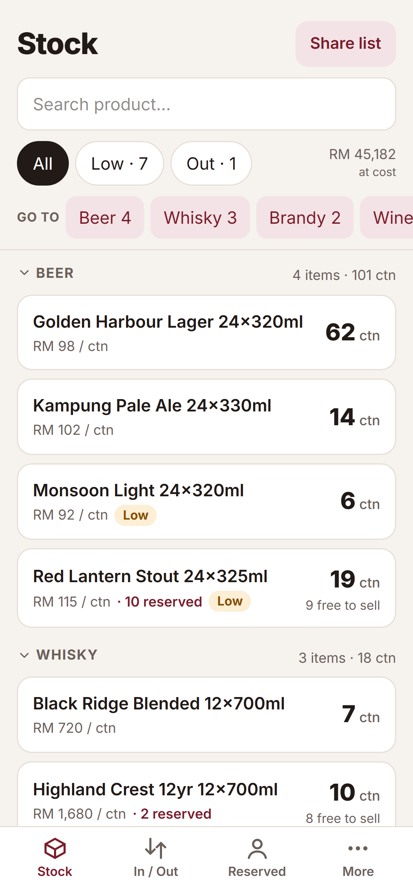
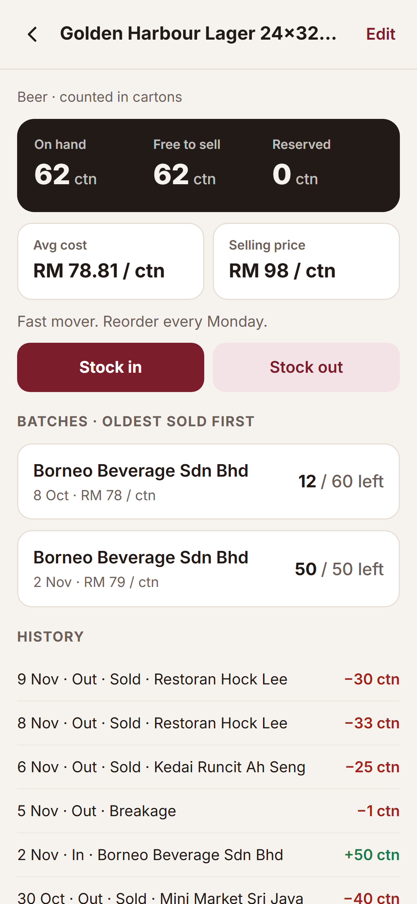
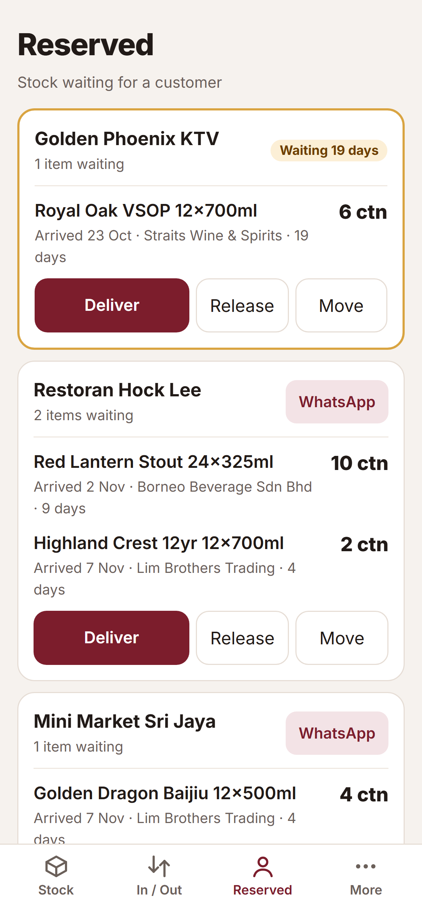
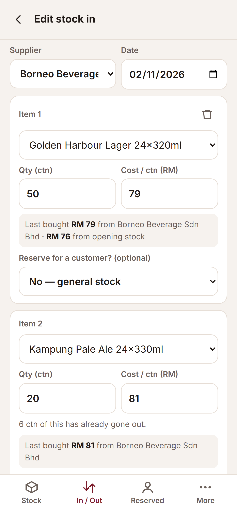
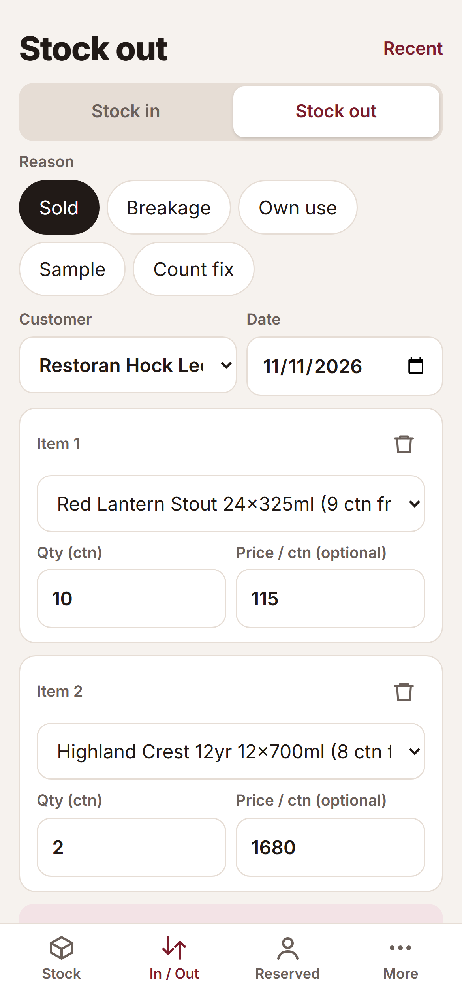
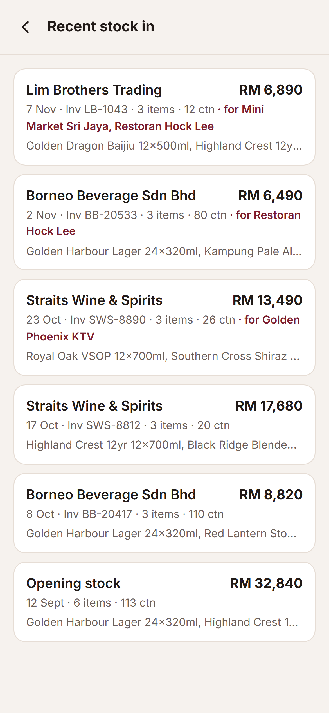

# YoHuo! (有货!)

> *有没有货？* — "Got stock?" is the question every customer asks. **YoHuo!** answers it.

A phone-first stock management app I built for my father's wholesale business.
He runs everything alone, from his phone, and used to keep stock levels in his head.
Now he can tell a customer exactly what's available, from anywhere.

> The source code is private. This repo is a showcase of the app and how it works.

---

## Screenshots

*Shown with made-up demo data.*

| Stock | Product detail | Reserved orders |
|---|---|---|
|  |  |  |

| Stock in | Stock out | Recent stock in |
|---|---|---|
|  |  |  |

---

## What it does (Stage 1: Stock)

- **Live stock by category.** See what's on hand at a glance, on any phone.
- **Stock in / stock out.** Record supplier deliveries and goods leaving, in a few taps.
- **FIFO costing.** Every delivery becomes a batch with its own cost. Stock going out takes from the oldest batch first, and that cost is locked in. Profit numbers stay correct from day one.
- **Reserved stock.** Mark cartons ordered specially for a customer. Anything waiting more than 14 days gets highlighted.
- **Oversell protection.** It warns before stock goes below zero, allows it after you confirm, and flags it.
- **Customers & suppliers.** Includes importing contacts straight from the phone.

## Roadmap

| Stage | Name | Status |
|---|---|---|
| 1 | Stock | ✅ Built |
| 2 | Sales orders: profit per order, WhatsApp receipts | Planned |
| 3 | Debts: who owes whom, payments | Planned |
| 4 | Profit & reports: expenses, monthly net profit | Planned |
| 5 | Safety & polish: Excel export, backups, home-screen install | Planned |

Each stage ships on its own. My father uses it for a week or two, then the next stage starts.

## How it's built

- **Next.js 16 + React + Tailwind**: static, client-side, phone-first UI
- **Supabase**: Postgres database and authentication (Singapore region)
- **Vercel**: hosting
- **All stock rules run inside Postgres functions.** FIFO, reservations, oversell and locked costs run in transactions, so every change saves completely or not at all.
- **330+ automated tests**: unit tests, database security/stress tests (PGlite), and screen tests (jsdom)
- Built with the help of [Claude Code](https://claude.com/claude-code)
